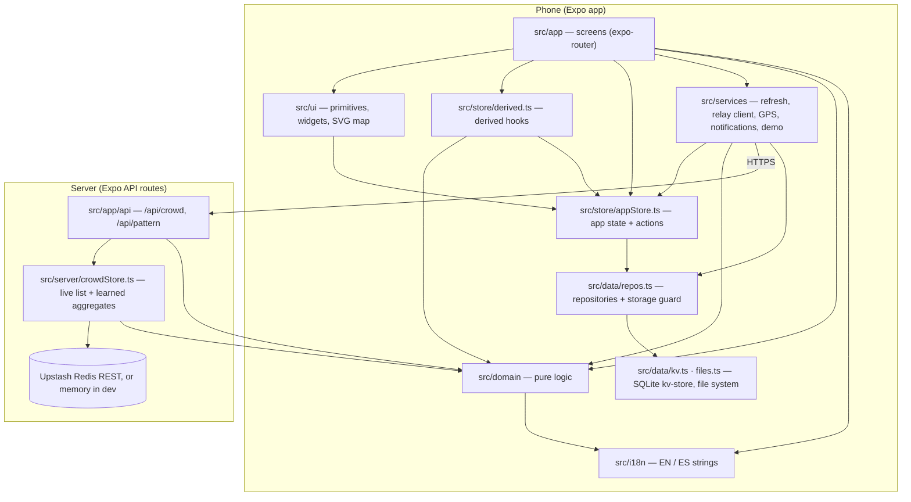

# StudySpace

Find a seat, study nearby. A local-first study-logistics app for New Jersey students. Congressional App Challenge 2026 · NJ.

**One claim.** The daily question is not "where is a library" but "is there a seat there right now, and will there be one when my train gets me there." Campuses do not answer it; students answer it with a group chat and a wasted 25-minute walk. StudySpace answers it with real published hours, honest crowd levels (student check-ins fused with a labelled typical pattern), walking minutes from the station, and a one-person study timer — and it keeps working with no signal, because a commuter in a basement stack has none.

## What it does (v1 — "find a seat")

| Tab / screen | What it shows | Offline? |
|---|---|---|
| **Now** (home) | Your free block today, spots ranked by seats-at-arrival × walk × stays-open × noise × amenities, level now and level when you arrive, closing-soon and open-past-midnight callouts, your week. | Yes — hours and the typical pattern never need a signal |
| Spot | Level with its honesty line ("2 reports agree · newest 3 min ago" / "Typical pattern · no live reports"), today's hours with exceptions (e.g. a renovation closure), the whole week, a typical-day curve, zones and their noise policy, walk from the station with the formula, accessibility, a watch toggle, your own check-ins, and every source. Hours whose typical level comes from student reports are underlined; the rest is a labelled estimate. | Yes |
| Check-in | ONE tap is a complete check-in. Optional zone, noise, what is available, a private note. Presence is a distance from GPS, read once and discarded. Without a fix you can say "I'm not at the spot" (counted lightly, labelled, replaced by any check-in from the spot). "Earlier visit" reports a day, hour and level from the last 7 days and feeds only the typical pattern. | Yes — queued and shared later if sharing is on |
| Why this ranking? | The five-term score, the fusion weights, the bucket boundaries, the confidence rules and the walking formula, with this spot's numbers filled in. | Yes |
| **Map** | Offline vector maps of New Brunswick, Newark, Hoboken and Princeton (OpenStreetMap lines bundled in the app), pins numbered by level, stations, your GPS dot. | Yes — zero network requests on this screen |
| **Focus** | A one-person study table: 25/5 × 4, 50/10 × 3, 90/15 × 2 or free; declared goals; pause, skip, end. Absolute timestamps, so a locked phone rejoins at the right block. Block changes arrive as local notifications. | Yes |
| Your week | Streak, focused time, goal rate, focus by hour of day, where you focus. Student-owned, exportable, never shared. | Yes |
| Offline data | What is saved, how big, and when. Refresh, sharing and notification toggles, demo scenarios, data licences, export, reset. | Yes |

Not in v1 (on purpose, and in the spec's own sequencing): shared study tables, buddy matching, boards, events, venue console, deals, the room-scan vision model, under-18 accounts. "Tables at low density are empty rooms, and empty rooms teach users the app is dead." Crowd data works at day one with a single user, so it ships first.

## Where the AI is (and is not)

- **Nowhere in v1.** Every number can explain itself on the "Why this ranking?" screen. Crowd level is a weighted fusion (`src/domain/levels.ts`): each report weighs `0.45 × proof (0.4–1.0) × ½^(age ÷ 25 min)`, the typical-pattern prior weighs `0.03`; the share is bucketed into five levels; confidence comes from how many fresh reports agree. Ranking is five weighted terms (`src/domain/ranking.ts`). Walking time is `metres × 1.3 ÷ 80` (`src/domain/transit.ts`). Hours are a table with an exception calendar (`src/domain/hours.ts`). The typical-day curves are per-kind estimates (`src/domain/curve.ts`) and say so on every screen they touch. The typical-day baseline is learned from student reports by one rule: an hour switches from the estimate to the students' weighted mean once it holds at least 5 reports from at least 3 distinct days (`PATTERN_MIN` in `src/domain/curve.ts`).
- **Why not.** The spec's own view: "the seat-count vision model is the most over-promisable piece … if accuracy is poor, ship without it — one-tap check-ins already work." And: "a student who travels 25 minutes on a wrong Chill does not report the bug, they delete the app." Under-promising is cheap; a model that cannot show its arithmetic is not.
- **Where it would go later.** Forecasting (per-zone quantile models once ≥ 2 weeks of real check-ins exist) and weekly clustering of check-in notes (k ≥ 5 before anything is shown). Both are batch jobs with deterministic publishing rules, not anything on the phone.

## Where the server is (and is not)

- **Two routes, one store:** `src/app/api/crowd+api.ts` (`POST` a report; `GET` the last three hours per venue) and `src/app/api/pattern+api.ts` (`GET` the learned baseline), both over `src/server/crowdStore.ts`. Reports come in three kinds: `live` (at the spot; weight = presence proof), `remote` (not at the spot; fixed low weight, shown as such, ignored once anyone at the spot reports) and `past` (an earlier visit; baseline only, never "right now"). The baseline is kept as per-venue monthly aggregates — count, weighted sum and distinct days per day type and hour, 120-day expiry — so no raw report is retained for it. The routes accept no notes, no identities, no coordinates: what is not collected cannot leak. Storage is an Upstash-compatible Redis (REST, pipelined) when `CROWD_STORE_URL`/`CROWD_STORE_TOKEN` are set, else the dev-server memory (gone on restart; the app says "dev relay"). Fusion happens on the phone with the same domain code, so the routes are dumb, replaceable pipes. Rate-limited per IP.
- **Nowhere else.** No accounts, no login, no analytics. The phone holds a key for nothing.

External APIs: 0 · API keys needed by the phone: 0 · Server functions: 2 (one store).

## Stack

Expo SDK 57 · expo-router · React Native 0.86 · TypeScript. Local storage is `expo-sqlite/kv-store` (synchronous reads, so the first frame renders from disk) plus `expo-file-system` for a downloaded directory; web falls back to localStorage. Map: `react-native-svg` drawing simplified OSM lines (≈ 140 KB for four areas) — no tiles, no map SDK, no API key. Clock: `America/New_York` via Intl, so library hours are library time whatever the phone is set to. Local notifications for block changes and watched spots. English and Spanish follow the device language (`src/i18n`); every string in the app goes through one dictionary.

Same design system as the sibling project `nmi-typhoon-watch`: native iOS grouped-list idiom, one accent, three semantic colours (navy information · red Packed/Full · green Empty/Chill; amber for Filling, closing soon and stale data), no shadows, 44 pt targets, body ≥ 15 pt, tabular numerals, no spinners, every cached thing time-stamped, demo data labelled wherever it appears.

## Run it

```bash
npm install
cp .env.example .env.local  # optional: CROWD_STORE_URL/TOKEN for a persistent relay (docs/backend-setup.md)
npx expo start              # press i / a / w
```

Everything works in Expo Go. The relay works out of the box on the Metro dev server (in-memory): two phones on the same network see each other's check-ins. For local notifications with a custom channel, build a development client (`npx expo run:ios` / `npx expo run:android`).

## Verify

```bash
npm run typecheck   # tsc --noEmit
npm run lint        # expo lint
npm test            # jest: levels & fusion, hours & time zone (DST), ranking, timer, focus stats, bundled data, crowd relay, storage guard, refresh policy, Phase 1 gaps, i18n dictionaries, screen smoke tests (zero network)
npx expo-doctor     # no issues; after an Expo SDK patch release run `npx expo install --fix` first
```

Manual acceptance procedures T1–T10, the six-state matrix and the demo script are in [docs/QA.md](docs/QA.md).

## Build, deploy, release

Identifiers: iOS `com.27363.studyspace`, Android `com.tstst.studyspace` (see `app.json`). Profiles live in `eas.json`. Commands below use EAS CLI 16 or newer (`npm i -g eas-cli`).

**1. Deploy the relay and set the three environment values:** [docs/backend-setup.md](docs/backend-setup.md). Repeat the `eas env:set` lines with `--environment preview` and `--environment development` for those profiles. Optional directory feed (JSON shaped like `assets/data/venues.json`):

```sh
eas env:set --name EXPO_PUBLIC_VENUES_URL --value https://<host>/nj-study-spots.json --environment production --visibility plaintext
```

**2. Builds**

```sh
eas build --profile development --platform ios            # dev build for a real iPhone (notifications, T1–T10)
eas build --profile development-simulator --platform ios  # same, for the iOS Simulator
eas build --profile preview --platform android            # installable APK
eas build --profile production --platform all             # store builds, version auto-incremented
eas submit --profile production --platform ios            # TestFlight / App Store
eas submit --profile production --platform android        # Play Console
```

## Demo scenarios

Offline data → **Demo & testing** → Live / Finals / Quiet / Late night. A scenario shifts the app clock (3 PM, 9:30 AM or 11:35 PM on a weekday) and injects simulated reports so the ranking, the closing-soon logic and the finals exception can be shown at any time of day. Demo reports are labelled wherever they appear and are never uploaded. "Simulate no signal" shows the OFFLINE banner and blocks all network calls; the real test is airplane mode.

Deep links for every scenario, area and spot: [docs/QA.md § Deep links](docs/QA.md#deep-links).

## Data and licences

- Hours: published schedules of Rutgers University Libraries (LibCal), NJIT Library, Stevens Library, New Brunswick Free Public Library, Newark Public Library, Hoboken Public Library (incl. the 2026 renovation closure) and Princeton Public Library, read 3 Oct 2026; café hours from a public listing. Evidence trail per venue in [docs/venue-sources.md](docs/venue-sources.md). Seat counts are not published by any venue and are not invented.
- Coordinates and map lines: © OpenStreetMap contributors, ODbL 1.0 — https://www.openstreetmap.org/copyright. The simplified lines in `assets/data/maps/` are derivative databases and stay under ODbL.
- Transit modes: NJ Transit, PATH and Amtrak public system maps.
- Typical-day curves: per-kind estimates (`src/domain/curve.ts`), labelled "estimate" everywhere; they are the cold-start prior the spec calls for, not data. Once students' reports reach the threshold for an hour, that hour shows their data and says so.
- Venue names are real institutions used because students study there. No partnership, endorsement or data relationship is implied.

## Technical breakdown

This section is for developers reading the code for the first time. It explains how the pieces fit, follows the main flows end to end, and lists what every file does. Every function, component and method in `src/` also carries a comment saying what it does and why; start from the file named in each step below.

### Layers



Rules the code keeps:

- **`src/domain` has no React, no storage and no network.** The logic takes `now` as an argument. The only clock is `nowMs()` in `src/domain/time.ts` (device time plus the demo offset that `setClockOffset()` sets); `nowIso`, `relativeAgo` and `isStale` fall back to it when no `now` is passed, and `newId` in `ids.ts` falls back to `Date.now()` plus a random part. Display text comes from `src/i18n`, so it follows the language chosen at boot. The phone and the server import the same functions (the relay route uses the level midpoints and weights; `src/server/crowdStore.ts` uses the New Jersey clock and the day-type helper), so both sides compute the same thing.
- **Screens never fetch.** They read state through hooks (`useAppState`, `useLiveLevels`, `useRanking`, …) and change it through `actions` or a service (`refreshAll`, `submitCheckIn`, `acquireLocation`). The one exception is the Offline data screen, which reads sizes from `files` / `venueRepo` and resets through `resetAllData()` then `hydrate()`.
- **Disk first, network second.** The store hydrates synchronously from local storage before the first frame; every network result is written to disk with a time stamp before it reaches the UI, and rendering never waits on the network. The one wait: after Post, the check-in and earlier-visit screens leave once the immediate upload answers or times out (at most 10 s); the report is already saved on the phone by then.
- **Two clocks.** `nowMs()` is the app clock (device time plus the demo-scenario offset) and drives everything about hours and levels in the app (the background watch poll uses device time). Facts stamped in device time — a GPS fix, a cache download — are compared with `Date.now()` / `useRealNow()`, never with the demo clock.
- **Every visible string goes through `t()`/`tn()`** (`src/i18n`), with English and Spanish dictionaries kept key-for-key identical by a test.

### Flow 1 — from launch to the first frame

1. `src/app/_layout.tsx` runs at module scope: `setLocale()` picks English or Spanish from the device, then `hydrate()` (`src/store/appStore.ts`) reads prefs, settings, venues, stations, check-ins, the crowd snapshot, the learned pattern, the running session, the focus log and watches from `src/data/repos.ts` synchronously.
2. Once onboarding is done, the first render already shows ranked spots: hours and the typical pattern need no network. On a first launch the root stack shows only the onboarding screen.
3. After mount the layout restores the demo scenario if one was on, starts the network watcher, configures notifications, registers the background watch poll, and calls `refreshIfStale()` in three cases: whenever the network watcher reports online (its first reading, so right at launch when there is a signal, and every change back to online), on every return to the foreground, and every 5 minutes while open.

### Flow 2 — a refresh

`refreshAll()` in `src/services/refresh.ts` (one run at a time; concurrent callers share it):

1. Offline → nothing is fetched and nothing is stamped. Online → `lastRefreshAt` is stamped at the start, so the 5-minute policy measures from the attempt.
2. Low on space → `dropLowPriority()` gives up re-downloadable caches first (learned pattern, then crowd snapshot), then older check-ins, and the app says what it dropped.
3. `syncCheckIns()` uploads own reports that have not reached the relay (only when sharing is on).
4. In parallel: `refreshCrowd()` (`GET /api/crowd` for the venues in your area), `refreshVenues()` (optional directory feed) and `refreshPattern()` (`GET /api/pattern`, at most every 6 hours).
5. `watchHits()` checks watched spots against the fresh reports and `notifyWatchHits()` posts local notifications (never for evidence that only comes from students who were not there).

### Flow 3 — the level a spot shows

`useLiveLevels()` (`src/store/derived.ts`) builds, for every venue, the list of reports that count — your own check-ins, the relay's reports minus echoes of your own (`dedupeReports`), and demo reports — and calls `fuse()` (`src/domain/levels.ts`):

- **Prior:** `typicalPct()` (`src/domain/curve.ts`) — the learned student pattern for this weekday type and hour once it holds ≥ 5 reports from ≥ 3 distinct days (`PATTERN_MIN`), else the per-kind estimate curve (or the venue's own declared curve), scaled ×1.35 while the Finals demo scenario runs; `TERM_MULTIPLIER` also has a ×0.4 break factor, but nothing sets that phase yet. Weight `0.03`.
- **Reports:** each weighs `0.45 × proof × ½^(age ÷ 25 min)` (40 min on weekends); proof is 0.4–1.0 from GPS distance for `live`, a fixed 0.25 for `remote`; reports older than 3 h are ignored; `past` reports never count here. Remote reports count only while nobody at the spot has reported.
- **Result:** the weighted share is bucketed into Empty / Chill / Filling / Packed / Full (boundaries 20 / 45 / 70 / 90 %). Confidence is `high` for two fresh (≤ 20 min) agreeing reports, `medium` for one recent (≤ 45 min) report with strong proof or two of any strength, `low` otherwise, `none` without reports — remote reports never raise it. `low` or `none` confidence widens the published range upward (share × 1.2 + 5 points); at `medium`, recent reports more than one level apart widen it up to the highest of them ("Filling to Packed").
- `confidenceText()` turns that into the honesty line shown with the level on the spot page (hero and zone rows), the Map tab and "Why this ranking?" ("2 reports agree · newest 3 min ago", "1 report, just now · not at the spot", "Typical pattern · from student reports"). The Now tab's rows show only the level now and on arrival.

### Flow 4 — the ranking on the Now tab

`useRanking()` picks the origin (your GPS fix if it is inside your area, else your home station or the area's default station, else the area centre) and calls `rankVenues()` (`src/domain/ranking.ts`). For each venue in the area: walking minutes (`ceil(straight-line metres × 1.3 ÷ 80)`, at least 1, `src/domain/transit.ts`), the level predicted for your arrival (`predictAt()`: the live level's deviation from the typical day fades with a 45-minute half-life toward the typical level at arrival time), and a score of `0.35 seats + 0.25 proximity + 0.15 stays-open + 0.15 noise fit + 0.10 amenities`. Spots open on arrival are sorted by score; the rest by next opening. "Why this ranking?" (`src/app/why/[id].tsx`) prints every term with this spot's numbers.

### Flow 5 — a student report

Three kinds, one record type (`CheckIn` in `src/domain/types.ts`), one path:

| Kind | Made on | Counts for | Weight |
|---|---|---|---|
| `live` | Check-in screen, at the spot | right now + the learned pattern | GPS proof 0.4–1.0 |
| `remote` | Check-in screen with "I'm not at the spot" | right now (until anyone at the spot reports) + the pattern | 0.25 |
| `past` | Earlier-visit screen (`src/app/report/[id].tsx`), a day and hour in the last 7 days | the learned pattern only | 0.5 |

`submitCheckIn()` saves the record on the phone and, when sharing is on and the phone is online, posts it at once; if the phone is offline or the post fails, `syncCheckIns()` posts it on the next refresh (provided sharing is still on). With sharing off, or in a demo scenario, it never leaves the phone. Notes, identity and coordinates never leave the phone; the body carries the venue, optional zone, level, time, kind, weight, optional noise and amenities, and the check-in's own id (`ci_` + its creation time + a random part, nothing about the student), which the relay uses only to recognise a re-sent earlier-visit report.

### Flow 6 — the relay and the learned pattern

`POST /api/crowd` (`src/app/api/crowd+api.ts`) rate-limits per IP (300 per 10 min, counting every attempt), validates the body (zod), rejects stale times with 422 (`live`/`remote` older than 3 h, `past` older than 7 days, anything more than 5 min ahead), sets the weight (live proof clamped to 0.4–1; `remote` / `past` forced to 0.25 / 0.5), and then:

- `live` / `remote` → the venue's 3-hour live list (latest 200 arrivals), skipped (and not aggregated) when its stored form — minute-rounded time, server-set weight, kind, zone, level, noise, amenities — matches a row already there; this catches a re-sent body, and also merges same-minute twins from different phones;
- `past` → skipped if the same per-report id was seen in the last 3 hours (a retry);
- every accepted report → `record()` in `src/server/crowdStore.ts` adds it to the venue's monthly aggregate bucket for its New Jersey day type (weekday / Saturday / Sunday) and hour: count, weighted sum, weight sum and a set of distinct dates.

`GET /api/pattern` merges the last three months into 24 × 3 buckets per venue. The phone keeps that snapshot (`patternRepo`) and decides per bucket whether it has earned the right to replace the estimate. Nothing raw is retained for the pattern. Only the three most recent months are read, so a new term takes over by itself; on Redis a month's keys also expire 120 days after its last write (the dev memory store keeps them until restart).

### Flow 7 — a focus session

A `Session` stores absolute timestamps (`startedAt`, `pausedAt`, `endedAt`) plus the total time already paused (`pausedMs`), never a countdown, so a locked or killed app rejoins the right block. `blockAt()` (`src/domain/timer.ts`) derives the current block from the clock; `scheduleSessionNotifications()` (`src/services/notifications.ts`) books one local notification per remaining block boundary; pause cancels them, and resume and skip rewrite the timestamps and book them again. Ending a session turns it into a `FocusEntry` in the focus log, which feeds the streak, the week summary and the hour-of-day chart (`src/domain/focus.ts`).

### Numbers in one place

| What | Value | Where |
|---|---|---|
| Report weight | `0.45 × proof × ½^(age ÷ 25 min)`, 40 min half-life on weekends, ignored after 3 h | `FUSION` in `src/domain/levels.ts` |
| Typical-pattern weight | `0.03` | `FUSION.priorBase` |
| Proof strength | 1.0 at the door … 0.4 unknown; "strong" ≥ 0.65 | `proofStrength`, `STRONG_PROOF` |
| Weights without proof | remote 0.25, past 0.5 (forced by the relay too) | `KIND_WEIGHT` |
| Level boundaries | 20 / 45 / 70 / 90 % | `LEVEL_BOUNDS` |
| Confidence windows | fresh ≤ 20 min, recent ≤ 45 min, zone rows ≤ 90 min | `FUSION` |
| Learned hour | ≥ 5 reports from ≥ 3 distinct days | `PATTERN_MIN` in `src/domain/curve.ts` |
| Term phase | finals × 1.35 (set only by the Finals demo scenario), break × 0.4 (defined, never set); scales the typical curve, never a learned hour | `TERM_MULTIPLIER` |
| Ranking | 0.35 seats + 0.25 proximity + 0.15 stays open + 0.15 noise + 0.10 amenities; proximity is 0 at 30 min | `RANK_WEIGHTS`, `MAX_WALK_MIN` in `src/domain/ranking.ts` |
| Walking time | `ceil(metres × 1.3 ÷ 80)` | `src/domain/transit.ts` |
| Arrival prompt | within 75 m (after crediting up to 50 m of GPS accuracy), hidden for 30 min after a live check-in there, fix ≤ 10 min old | `src/domain/arrival.ts` |
| Refresh | when the network reports online (so at launch), on return to the foreground and every 5 min while open; pattern at most every 6 h; background poll ≥ 15 min | `src/app/_layout.tsx`, `src/services/refresh.ts`, `src/services/backgroundPoll.ts` |
| Relay | live list 3 h (newest 200 per venue), past reports up to 7 days back, 300 posts / 10 min / IP, aggregates kept 120 days, pattern read over 3 months | `src/server/crowdStore.ts`, `src/app/api/crowd+api.ts` |
| On the phone | own check-ins 30 days (max 300), focus log 2,000 entries, storage guard below 5 MiB free | `src/data/repos.ts` |

### Module reference

Every file starts with a header comment that says the same in more detail.

**`src/app` — screens (expo-router) and the two API routes**

| File | What it does |
|---|---|
| `_layout.tsx` | App shell. Before the first frame: language from the device, store hydrated from disk. After mount: demo scenario restored, network watch, notification setup, background poll registered, refresh when the network reports online, on return to the foreground and every 5 minutes. Declares the root stack (onboarding until it is done). |
| `(tabs)/_layout.tsx` | Bottom tab bar (Now, Map, Focus); each tab mounts on its first visit. |
| `(tabs)/index.tsx` | **Now**: today's free block, spots ranked with the level now and on arrival, closing-soon and past-midnight callouts, the arrival prompt (one tap opens the check-in form for the spot you are standing at), closed spots, your week. |
| `(tabs)/map.tsx` | **Map**: the offline map of one area, legend, "All spots / Open late" layer, spots grouped by campus. No network. |
| `(tabs)/focus.tsx` | **Focus**: the start form (timer shape, place, goals) or the live session (ring, pause, resume, skip, end, goals); ending writes a focus-log entry. |
| `spot/[id].tsx` | Spot detail: level, honesty line and arrival level; hours and exceptions; typical-day chart with learned hours underlined; zones with their own levels; amenities; getting there; late-night safety numbers; accessibility; watch; your reports; sources. |
| `checkin/[id].tsx` | Check-in: the level is the only required answer (pick one, then "Post check-in" or "Post and start a session here"); optional zone, noise, what is available, private note; presence from one GPS fix; "I'm not at the spot" turns it into a `remote` report. |
| `report/[id].tsx` | Earlier visit: a day in the last 7, an hour the spot was open, optional zone, a level → a `past` report. |
| `why/[id].tsx` | "Why this ranking?": four plain reasons, then the full arithmetic on request. |
| `data.tsx` | Offline data: every saved item with its size, plus the age of each download (flagged "Old" when stale), manual refresh, storage-guard notice, sharing and notification switches, demo scenarios, export, reset. |
| `profile.tsx` | Your week: focus time, sessions, goal rate, streak, shown-vs-found, focus by hour, where you focus, settings links. |
| `prefs.tsx`, `onboarding.tsx` | Preferences editor and the first-run screen, both built on `PrefsForm`. |
| `blocks.tsx` | Free blocks (gaps between classes) editor. |
| `privacy.tsx` | What is shared and what never leaves the phone; its header names the code that enforces most lines (upload body, relay retention, GPS fix, note retention, notifications, demo data). |
| `+not-found.tsx` | Fallback for an unknown route or deep link. |
| `api/crowd+api.ts` | `GET` recent reports per venue; `POST` one report: validation, rate limit, forced weights, retry de-duplication, aggregates. |
| `api/pattern+api.ts` | `GET` the learned baseline: 24 hours × weekday / Saturday / Sunday per venue, merged over 3 months. |

**`src/server`**

| File | What it does |
|---|---|
| `crowdStore.ts` | Storage behind both routes: the 3-hour live list, the monthly aggregates and the 3-hour seen set, in memory (dev) or Upstash Redis REST (pipelined). `bucketOf` maps a report to its New Jersey day type and hour. |

**`src/domain` — pure logic, shared by the phone and the relay**

| File | What it does |
|---|---|
| `types.ts` | The shared data shapes (stored on the phone or sent over the wire): venues, hours, zones, stations, check-ins and reports, the learned pattern, fused levels, sessions, prefs, settings, cache bookkeeping. Shapes used by one module (e.g. `OpenState`, `RankedVenue`, `BlockState`) are declared in that module. |
| `time.ts` | The New Jersey clock: app clock with the demo offset, wall-clock parts (DST-safe, memoised per minute), conversions, and the shared date, time and duration formatters (clock times, relative ages, "in 25 min", durations, MM:SS). |
| `hours.ts` | Opening hours with exception calendars: open or closed at an instant (including closes past midnight), next opening, closing soon, "until midnight" labels, validation. |
| `levels.ts` | Fusion into five levels with confidence, range and honesty line; proof strength; report kinds and weights; echo de-duplication; zone levels; arrival prediction. |
| `curve.ts` | The typical-day baseline: per-kind estimate curves, term multipliers, learned buckets and their explanation. |
| `ranking.ts` | The five-term score, open and closed lists, explanation rows. |
| `transit.ts` | Walking minutes and the printed formula; station lookups. |
| `timer.ts` | Focus-timer math on absolute timestamps: shapes, schedule, current block, focus seconds, upcoming boundaries, the focus-log row. |
| `focus.ts` | Your-week statistics from the focus log: streak, week summary, focus by hour, best window, focus per spot, goal rate. |
| `blocks.ts` | Free blocks: the current or next gap, validation, formatting. |
| `arrival.ts` | Which spot the phone is standing at, for the Now tab's arrival prompt. |
| `honesty.ts` | Shown-vs-found: how often the level a student found at the spot was within one level of what the app showed. |
| `safety.ts` | Late-night campus safety contacts per venue. |
| `areas.ts` | The four pilot areas: names, bounding boxes, default stations. |
| `geo.ts` | Distance, bounding-box test, the projection that turns map lines into SVG paths. |
| `ids.ts` | Local record ids (no accounts, no server ids). |

**`src/data` — storage on the phone**

| File | What it does |
|---|---|
| `repos.ts` | One synchronous repository per record kind (prefs, settings, venues, stations, check-ins, crowd and pattern caches, session, focus log, watches, cache metadata) and the storage guard: on a full disk it drops the pattern cache, then the crowd cache, then older check-ins, retries once and says what it dropped. |
| `kv.ts`, `kv.web.ts` | Synchronous JSON key-value store: SQLite `kv-store` on phones, `localStorage` on web. Never throws. |
| `files.ts`, `files.web.ts` | The downloaded venue directory on disk, and free-space checks. |
| `mapData.ts` | The four bundled vector maps. |

**`src/store` — state**

| File | What it does |
|---|---|
| `appStore.ts` | The single app state on `useSyncExternalStore`, `hydrate()`, `isOfflineNow()`, and `actions`: the persisting ones write through the repositories first and then notify subscribers; the memory-only ones (network state, GPS fix, demo reports, refresh progress, and data their callers already saved) only notify. |
| `derived.ts` | Hooks that combine state with domain logic: `useNow` / `useRealNow` (the two clocks), venues with demo exceptions, live levels, the ranking, the running session, focus statistics. |

**`src/services` — side effects**

| File | What it does |
|---|---|
| `refresh.ts` | Refresh orchestration, check-in submit and sync, crowd / pattern / directory refresh, watch hits. |
| `crowdClient.ts` | The relay client: requests with a 10-second timeout, responses re-checked before they reach fusion. |
| `notifications.ts` | Local notifications for watched spots and focus-block changes; permission asked only when something is about to be delivered. |
| `backgroundPoll.ts` | Background check of watched spots (development and production builds on Android and iOS, not Expo Go or web; on iOS only physical devices run it, never the simulator). |
| `location.ts` | One GPS fix (last known, then fresh), kept in memory only. |
| `network.ts` | Connectivity into the store: `startNetworkWatch()` reads expo-network once at boot and on every change. (`isOfflineNow()`, which adds the "Simulate no signal" switch, lives in `src/store/appStore.ts`.) |
| `demo.ts` | Demo scenarios: a clock shift plus simulated reports that are the same every time and never uploaded. |

**`src/ui` — components without app state**

| File | What it does |
|---|---|
| `primitives.tsx` | Grouped-list building blocks: text styles, section header and footer, Group, Cell, Button, Toggle, Checkbox, Segmented, Field, Callout, progress ring and bar, KeyValue. |
| `Screen.tsx` | The page layout: offline banner, back bar, large title, status line, pull-to-refresh. |
| `level-widgets.tsx` | Level bars, level line and hero, typical-day chart, focus-by-hour chart, the zone and level pickers of both report forms. |
| `session-widgets.tsx` | Timer ring, block strip, goal rows. |
| `AreaMap.tsx` | The offline SVG map and its legend. |
| `icons.tsx`, `ion-fallback.tsx`, `ion-fallback.ios.tsx` | One icon vocabulary: SF Symbols on iOS, Ionicons elsewhere; the `.ios` file keeps the Ionicons font out of the iOS build. |
| `PrefsForm.tsx` | The preferences form shared by onboarding and Preferences. |
| `theme.ts` | Colours, text styles, spacing and radii. |

**`src/i18n`** — `index.ts` (`t`, `tn` for plurals, `tlist`, `setLocale`), `en.ts` (keys and English), `es.ts` (Spanish, type-checked to have every key).

### Tests

| File | Covers |
|---|---|
| `levels.test.ts` | Buckets, proof strength, decay, fusion and confidence, ranges, echo de-duplication, zone levels, report kinds, the learned baseline |
| `hours-time.test.ts` | New Jersey time and DST, hours past midnight, exceptions, next opening, labels |
| `ranking-timer-focus.test.ts` | Ranking, timer blocks and pauses, focus statistics |
| `crowd-api.test.ts`, `pattern-api.test.ts` | The relay: validation, rate limit, kinds and weights, retries, aggregates on memory and on a fake Redis REST server |
| `crowd-client.test.ts`, `refresh.test.ts`, `storage-guard.test.ts` | Wire format, refresh policy and cadence, watch rules, the storage guard |
| `phase1-gaps.test.ts`, `bundled-data.test.ts`, `i18n.test.ts` | Arrival prompt, honesty metric, safety contacts, bundled data integrity, EN / ES parity |
| `screens.test.tsx` | Every screen except `+not-found` rendered offline, zero `fetch` calls asserted on Now, Map, check-in and the earlier-visit report, plus the main interactions |

## Project layout

```
src/app/            expo-router screens (+ api/crowd+api.ts and api/pattern+api.ts server routes)
src/server/         relay storage: the 3-hour live list and the learned-baseline aggregates (memory or Upstash Redis REST)
src/domain/         pure logic: types, time zone, hours & exceptions, typical curves, level fusion & confidence, ranking, transit, timer, focus stats, free blocks
src/data/           local storage (kv + files, with .web.ts fallbacks), repositories, bundled map data
src/services/       network state, crowd relay client (reports + learned baseline), refresh orchestration, notifications, GPS, demo scenarios
src/store/          useSyncExternalStore app store + derived hooks (live levels, ranking, session, stats)
src/ui/             theme tokens, icons, primitives, level & session widgets, SVG area map
src/i18n/           English and Spanish dictionaries, t()/tn() helpers (device language at boot)
assets/data/        bundled directory (19 venues), stations, four area maps
assets/locales/     iOS display name and permission strings per language
__tests__/          unit + screen smoke tests (jest-expo)
docs/QA.md          acceptance procedures T1–T10, state matrix, demo script
docs/venue-sources.md  where every hour and coordinate came from
docs/backend-setup.md  the three values to supply and how to verify each step
docs/perf.md        bundle, render and startup baseline, what changed and what was left alone
docs/design.md      design direction, type scale, component rules, audit
docs/gap-analysis.md  spec vs app, item by item
```
